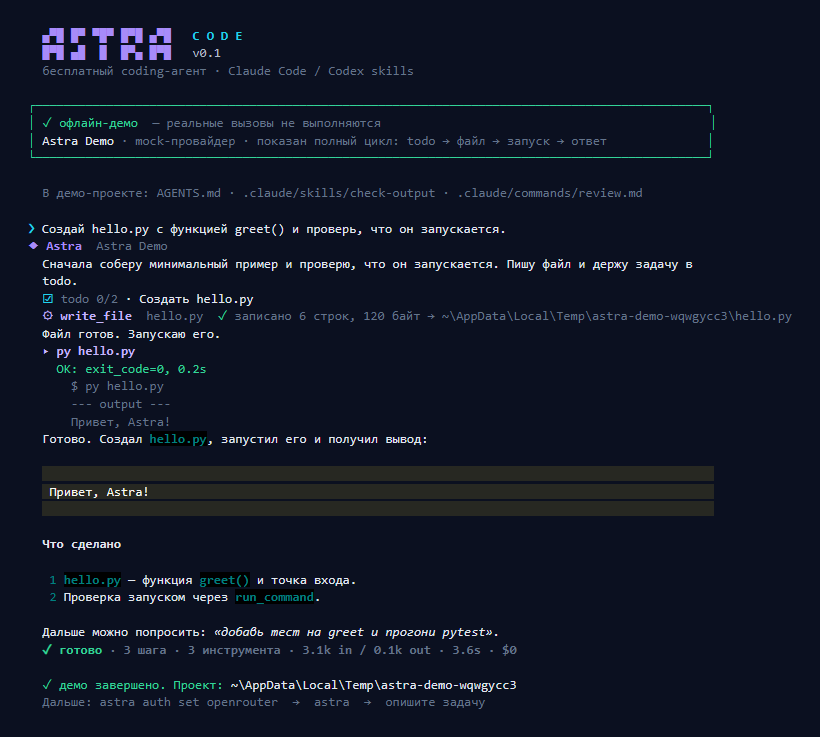

<div align="center">



# Astra Code

**Бесплатный терминальный coding-агент. Claude Code-подобный цикл, только на free-tier.**

`Python 3.11+` · `Windows / macOS / Linux` · `MIT` · **71 тест**

</div>

---

## Что это

Astra Code — самостоятельный coding-агент для терминала: читает файлы, ищет по репозиторию,
правит код, запускает тесты и команды, ведёт todo, сжимает контекст и делегирует подзадачи
субагентам. Всё общение с моделями идёт через **бесплатные** API-провайдеры; платные модели
заблокированы по умолчанию.

Это не форк Claude Code и не обёртка над ним. Это Python-проект с собственной архитектурой,
но он читает те же расширения экосистемы: `CLAUDE.md`, `AGENTS.md`, `.claude/skills`,
`.claude/agents`, `.claude/commands`, `.codex/prompts` и `SKILL.md`.

```text
  ▄▀█ █▀ ▀█▀ █▀█ ▄▀█   C O D E
  █▀█ ▄█  █  █▀▄ █▀█   v0.1
  бесплатный coding-агент · Claude Code / Codex skills
```

## Почему бесплатно

Astra не продаёт токены и не проксирует трафик через свой сервер. Ключи лежат у вас,
запросы идут напрямую провайдеру, а роутер умеет только те модели, которые провайдер
отдаёт бесплатно.

| Провайдер | Переменная | Что бесплатно | Ограничения free-tier |
|---|---|---|---|
| **[OpenRouter](https://openrouter.ai/keys)** | `OPENROUTER_API_KEY` | ~16 моделей с суффиксом `:free` | 20 req/min, 50 req/день (1000 после разовой покупки 10 кредитов); карта и телефон не нужны |
| **[OmniRoute](https://github.com/diegosouzapw/OmniRoute)** (локально) | `OMNIROUTE_API_KEY` | 500+ моделей из 11 free-провайдеров + combo; 5 проверенных Kiro | Нужен запущенный `omniroute serve`; ключ импортируется из `~/.omniroute` |
| **[Google Gemini](https://aistudio.google.com/apikey)** | `GEMINI_API_KEY` | Gemini 2.5 Pro / Flash / Flash-Lite, 1M контекст | Лимиты видны в AI Studio; free-tier промпты могут использоваться Google для обучения |
| **[Groq](https://console.groq.com/keys)** | `GROQ_API_KEY` | GPT-OSS 120B, Qwen 3.8 27B | ~30 req/min, 1000 req/день, 200k токенов/день; нужна верификация телефона |
| **[SambaNova](https://cloud.sambanova.ai/keys)** | `SAMBANOVA_API_KEY` | DeepSeek V3.1/V3.2, GPT-OSS 120B, Llama 3.3 70B | ~20 req/min, 20 req/день, 200k токенов/день; free tier действует, пока к аккаунту не привязана карта |
| **[Z.ai](https://z.ai/manage-apikey/apikey-list)** | `ZAI_API_KEY` | GLM-4.7-Flash, GLM-4.5-Flash, GLM-4.6V-Flash | Официально $0 бессрочно |
| **[Cloudflare Workers AI](https://dash.cloudflare.com/profile/api-tokens)** | `CLOUDFLARE_API_TOKEN` + `CLOUDFLARE_ACCOUNT_ID` | Qwen2.5 Coder 32B, Llama 3.3 70B, DeepSeek R1 Distill | 10 000 Neurons/день, сброс в 00:00 UTC |
| **[Mistral](https://console.mistral.ai/api-keys)** | `MISTRAL_API_KEY` | Free mode La Plateforme | Лимиты в консоли; по умолчанию данные могут использоваться для обучения |
| **[Ollama Cloud](https://ollama.com/settings/keys)** | `OLLAMA_API_KEY` | Стартовые кредиты free-плана | 1 параллельный запрос, кредиты обновляются ежемесячно |
| **[Ollama](https://ollama.com/download)** | — | Локальные open-weight модели | Полностью бесплатно и приватно; нужен свой сервер |
| **[LM Studio](https://lmstudio.ai/)** | — | Локальный OpenAI-совместимый сервер | Полностью бесплатно; нужен Local Server |
| **Свой endpoint** | `CUSTOM_API_KEY` | Любой OpenAI-compatible API | Настраивается через `astra auth set custom --base-url` |

> Данные о free-tier сверены с публичным датасетом
> [free-llm-api-hub 2.11.0](https://github.com/pacocartones/free-llm-api-hub)
> (последняя проверка провайдеров — 2026-10-08). Тарифы меняются: перед оплатой
> всегда проверяйте официальную страницу провайдера.

**Чего здесь нет и почему:** у OpenAI, Anthropic и xAI нет постоянного бесплатного API;
GitHub Models полностью закрыт 2026-07-30; Cerebras перешёл на trial-кредит. Поэтому этих
провайдеров в Astra нет — обещание «бесплатно» важнее длины списка.

### OmniRoute: локальный free-роутер

Если у вас уже стоит [OmniRoute](https://github.com/diegosouzapw/OmniRoute), Astra может
ходить через него как через один OpenAI-совместимый провайдер. На этой машине OmniRoute
3.8.52 отдал **516 моделей** от 11 free/keyless-провайдеров (aihorde, kiro, agy,
cloudflare-playground, duckduckgo-web, auggie, zcode, uncloseai, combo и др.) на 2026-11-07;
список живой и меняется между запросами.

```powershell
# 1. Сервер OmniRoute (loopback — безопаснее, чем 0.0.0.0 по умолчанию)
$env:OMNIROUTE_SERVER_HOST='127.0.0.1'
omniroute serve --daemon --no-open --headless

# 2. Импорт локального ключа в ~/.astra/auth.toml (без вывода ключа)
.\.venv\Scripts\astra.exe auth set omniroute --from-omniroute

# 3. Все модели и только проверенные
.\.venv\Scripts\astra.exe models --provider omniroute --refresh
.\.venv\Scripts\astra.exe models --provider omniroute --verified
.\.venv\Scripts\astra.exe models --provider omniroute --limit 0   # все модели

# 4. Использовать конкретную модель
.\.venv\Scripts\astra.exe --model omniroute:kiro/qwen3-coder-next "исправь тест"
```

После настройки Astra Coder автоматически получает OmniRoute как ещё один fallback
(в конце цепочки), а `astra` без флагов уже работает через него, если других ключей нет.

**Что реально работало на 2026-11-07** (ping с `max_tokens=1`):

| Модель | Статус |
|---|---|
| `kiro/qwen3-coder-next` | ✅ работает, сильный код |
| `kiro/deepseek-3.2` | ✅ работает |
| `kiro/glm-5` | ✅ работает |
| `kiro/minimax-m2.5` | ✅ работает |
| `kiro/minimax-m2.1` | ✅ работает |
| `kiro/claude-*` | ⚠️ 429 upstream, лимит Kiro |
| `kiro/gpt-5.6-*` | ❌ `INVALID_MODEL_ID` |
| `cfp/*` (Cloudflare Playground) | ❌ нужен Playwright + Chromium |
| `cxa/*` (Codex app-server) | ❌ не настроен url/token |
| `dva/*` (Devin) | ❌ не настроен bridge sandbox |
| `agy/*` (Antigravity) | ⚠️ квота до 2026-11-08 |
| `zcode/*`, `auggie/*`, `ddgw/*`, `unc/*` | ❌ нет CLI/токена/таймаут |
| `auto/best-free`, `auto/coding:free` | ⚠️ сейчас падают на первом кандидате `cfp` |

Astra не выдаёт все 500+ за рабочие: `--verified` показывает только те, что прошли
живой ping. Остальные доступны для эксперимента, но их работоспособность зависит от
ваших OAuth-подключений и установленных CLI.

> OmniRoute по умолчанию слушает `0.0.0.0` без обязательного API-ключа на inference-plane.
> Для локальной машины задайте `OMNIROUTE_SERVER_HOST=127.0.0.1` (Astra так и делает в
> инструкции). Если нужен доступ по сети — включайте `REQUIRE_API_KEY=true`.

## Быстрый старт

Windows (рекомендуется `py`, а не `python`: алиас из Microsoft Store часто не работает):

```powershell
cd C:\path\to\astra
py -3 -m venv .venv
.\.venv\Scripts\python.exe -m pip install -e ".[dev]"

# 1. Посмотреть интерфейс без ключей
.\.venv\Scripts\astra.exe demo

# 2. Добавить бесплатный ключ (мастер откроет браузер и проверит ключ)
.\.venv\Scripts\astra.exe auth set openrouter

# 3. Запустить агента в папке проекта
cd C:\path\to\project
C:\path\to\astra\.venv\Scripts\astra.exe
```

Или одной командой на Windows — `start.bat` создаёт venv, ставит зависимости,
прогоняет тесты и запускает Astra:

```powershell
.\start.bat
.\start.bat test      # только тесты
.\start.bat demo      # офлайн-демо
.\start.bat doctor    # диагностика
.\start.bat build     # wheel + sdist в .\dist
```

macOS / Linux:

```bash
python3 -m venv .venv
.venv/bin/python -m pip install -e ".[dev]"
.venv/bin/astra demo
.venv/bin/astra auth set openrouter
```

Ключ хранится в `~/.astra/auth.toml` (best-effort 0600). Переменные окружения имеют приоритет,
`.env` читается из папки проекта и из `~/.astra/.env`. Пример — [`.env.example`](.env.example).

Проверка окружения:

```bash
astra doctor            # python, git, ключи, папки, расширения
astra doctor --network  # дополнительно пингует /models каждого провайдера
```

## Две собственные модели Astra

Astra Coder и Astra Reasoner — это **собственные композитные модели-профили**, а не обученные
с нуля веса (обучить frontier-модель в рамках такого проекта невозможно). Каждая состоит из
трёх частей: свой системный промпт, своя температура и free-only цепочка провайдеров с
автоматическим fallback при `429`/`5xx`.

| Модель | Для чего | Цепочка (первая доступная) |
|---|---|---|
| **⚡ Astra Coder** | код, рефакторинг, тесты, минимальные диффы | Groq GPT-OSS 120B → OpenRouter code models → Gemini 2.5 Pro → SambaNova → Z.ai → Cloudflare → … |
| **✧ Astra Reasoner** | архитектура, дебаг, plan-then-act | Gemini 2.5 Pro → SambaNova DeepSeek → OpenRouter reasoning → Groq → Z.ai → … |

```text
$ astra
✦ модель  Astra Coder · Groq
  openai/gpt-oss-120b · fallback: OpenRouter → Gemini → SambaNova
```

Если ключа Groq нет, Astra Coder молча начнёт с OpenRouter или Gemini. Если закончился
дневной лимит — переключится на следующего. Переопределить цепочку можно в `config.toml`:

```toml
[custom.astra-coder]
chain = ["gemini", "openrouter", "groq"]

[providers.groq]
model = "qwen/qwen3.8-27b"
```

## Дизайн


- **Aurora-тема**: фиолетово-циановый градиент, звёздный логотип, аккуратные рамки.
- **Живой статус**: одна строка `✻ Astra пишет · N симв.` вместо многострочного Live —
  так вывод не размножается в Windows Terminal и при скролле.
- **Финальный Markdown** с подсветкой кода, заголовками и таблицами.
- **Карточки инструментов**: `⚙ read_file`, `✎ write_file`, `▸ run_command`, diff-статистика
  `+12 −3`, время выполнения и честный `✗` при ошибке.
- **Todo-строка** `☑ todo 2/4 · текущая задача`.
- **Статус-бар** внизу: модель, контекст, режим подтверждений, папка.
- **Автодополнение**: `/команды` и `@файлы`; история в `~/.astra/history`.
- **Темы** `aurora` и `mono` (`/theme`), `--no-color` для CI.
- **Демо без ключей**: `astra demo` создаёт временный проект и проходит полный цикл
  todo → файл → запуск → Markdown.

Горячие клавиши: `Enter` — отправить, `Ctrl+J` — новая строка, `Ctrl+C` — отмена/выход
(дважды), `Ctrl+D` — выход, `Ctrl+L` — очистить экран.

## Claude Code и Codex: скиллы, агенты, команды

Astra читает расширения из проектных и пользовательских папок. Проектные переопределяют
пользовательские.

| Что | Где ищется | Формат |
|---|---|---|
| **Память** | `AGENTS.md`, `CLAUDE.md`, `ASTRA.md` в проекте и родительских папках; `~/.astra/ASTRA.md`, `~/.claude/CLAUDE.md`, `~/.codex/AGENTS.md` | Markdown, читается автоматически |
| **Скиллы** | `.claude/skills/<name>/SKILL.md`, `.codex/skills/...`, `.astra/skills/...`, `~/.claude/skills`, `~/.astra/skills`, `~/.claude/plugins/**/skills/**/SKILL.md` | YAML-frontmatter + Markdown |
| **Субагенты** | `.claude/agents/*.md`, `.codex/agents`, `.astra/agents`, `~/.claude/agents` | `name`, `description`, `tools`, `model` |
| **Команды** | `.claude/commands/**/*.md` (namespace `db:migrate`), `.codex/prompts/*.md`, `.astra/commands` | frontmatter + `$ARGUMENTS`, `$1…$9` |

Пример скилла — [`.claude/skills/astra-release/SKILL.md`](.claude/skills/astra-release/SKILL.md):

```markdown
---
name: astra-release
description: Prepare an Astra release — check versions, run tests, update the changelog.
allowed-tools: read_file, edit_file, grep, run_command
argument-hint: <version>
---
# Astra release checklist
1. Read pyproject.toml and astra/__init__.py...
```

Пример субагента — [`.claude/agents/security-reviewer.md`](.claude/agents/security-reviewer.md):
read-only инструменты и модель `astra-reasoner`. Модель вызывает его через инструмент `task`.

Codex-часть: `AGENTS.md` в корне, [`.codex/prompts/review.md`](.codex/prompts/review.md),
[`.codex/skills/provider-smoke-test/SKILL.md`](.codex/skills/provider-smoke-test/SKILL.md).

Посмотреть, что найдено:

```bash
astra skills
astra agents
astra "перечисли доступные скиллы и загрузи релевантный"
```

Внутри сессии:

```text
/skills                 список
/skills astra-release   загрузить скилл в контекст
/agents                 субагенты
/commands               кастомные команды
```

> `allowed-tools` у скилла пока информационный: Astra не ограничивает набор инструментов
> при загрузке скилла. Это честно описано в ограничениях ниже.

## Инструменты и безопасность

| Инструмент | Что делает | Подтверждение |
|---|---|---|
| `read_file` | чтение файла с offset/limit | для `.env`/ключей |
| `write_file` | создать/перезаписать файл | да |
| `edit_file` | точная замена фрагмента, CRLF-safe | да |
| `list_dir` / `glob` / `grep` | дерево, поиск файлов и regex по содержимому | нет |
| `run_command` | PowerShell (Windows) / bash (Unix), timeout | да |
| `todo_write` | план задач | нет |
| `task` | субагент с ограниченным набором инструментов | наследует |
| `skill` | загрузка инструкций скилла | нет |
| `fetch_url` | публичный http(s), HTML → текст | нет |

- **Free-only guard.** OpenRouter-модель без `:free`, платный Gemini или Z.ai блокируются
  до запроса. Отключить защиту: `allow_paid = true` в конфиге.
- **Workspace sandbox.** Пути резолвятся и проверяются; выход за папку проекта требует
  отдельного подтверждения. `~/.astra/auth.toml` и база `~/.omniroute/storage.sqlite`
  агенту недоступны.
- **Approval modes.** `ask` (по умолчанию), `auto` (`--yes`), `readonly` (`--read-only`).
  Для каждой команды можно выбрать «всегда в этой сессии».
- **Секреты.** `.env`, `auth.toml`, `id_rsa`, `*.pem`, `credentials*` требуют отдельного
  подтверждения; их содержимое и вывод shell/`fetch_url` проходят через редакцию ключей
  (`sk-***`, `Bearer ***`, `API_KEY=***`). Дочерние процессы получают env **без**
  `*_API_KEY`, `*_TOKEN`, `*_SECRET`, `DATABASE_URL`, `AWS_*`, `AZURE_*`, `OMNIROUTE_*`.
- **Prompt injection.** Содержимое файлов, веб-страниц и вывода инструментов считается
  недоверенными данными; агенту запрещено выполнять инструкции оттуда, если они
  конфликтуют с пользователем или системными правилами.
- **Права.** `~/.astra` — best-effort 0700; `auth.toml`, `config.toml`, сессии и history —
  best-effort 0600 (на Windows ACL ограничены, но файлы не попадают в git).
- **Сеть.** `fetch_url` блокирует localhost, приватные, link-local и reserved-адреса,
  включая redirect на приватный адрес (SSRF); локальные файлы и `file://` запрещены.
- **Лимиты.** Файл — 1 МБ на чтение, 2 МБ на запись; вывод инструмента — 40k символов;
  shell — до 600 секунд; результат команды обрезается с сохранением начала и конца.

## CLI

```text
astra                              интерактивный REPL
astra "исправь падающий тест"      one-shot запрос
astra -p "объясни код"             только текст в stdout (pipe-friendly)
echo "..." | astra -p              stdin
astra demo                         офлайн-демо без ключей
astra auth list|set|test|remove    ключи; set omniroute --from-omniroute
astra models [--refresh] [--provider ID] [--verified] [--limit N]
astra skills | agents | commands   найденные расширения
astra doctor [--network]           диагностика
astra init [--force]               создать ASTRA.md
astra version
```

Глобальные флаги: `--model`, `--provider`, `--cwd`, `--yes`, `--read-only`,
`--continue`, `--resume [ID]`, `--theme`, `--no-color`, `--debug`.

## Слэш-команды

```text
/help  /model  /models  /provider  /keys  /setup
/skills [name]  /agents  /commands  /init
/compact  /clear  /cost  /resume [id]  /sessions
/theme [aurora|mono]  /reasoning  /approval [ask|auto|readonly]
/status  /doctor  /quit
```

Плюс `@path` — приложить файл к сообщению, `!command` — выполнить shell-команду.

## Конфигурация

`~/.astra/config.toml`:

```toml
provider = "openrouter"
model = "astra-coder"        # или astra-reasoner, groq:openai/gpt-oss-120b
theme = "aurora"
approval = "ask"             # ask | auto | readonly
max_steps = 40
max_tokens = 8192
temperature = 0.2
auto_compact = true
show_reasoning = false
allow_outside = false
allow_paid = false

[providers.groq]
model = "openai/gpt-oss-120b"

[custom.astra-coder]
chain = ["groq", "openrouter", "gemini"]
```

`~/.astra/auth.toml`:

```toml
[keys]
openrouter = "sk-or-..."
[options.cloudflare]
account_id = "..."
```

## Архитектура

```text
astra/
├── astra/
│   ├── cli.py           argparse, подкоманды, one-shot/REPL
│   ├── config.py        config.toml + auth.toml, TOML-сериализатор
│   ├── catalog.py       12 провайдеров, free-only правила, 2 модели Astra
│   ├── providers.py     OpenAI-compatible SSE-клиент + mock
│   ├── router.py        fallback-цепочки, кэш моделей, выбор модели
│   ├── agent.py         tool-calling цикл, compaction, субагенты
│   ├── tools.py         11 инструментов, approval, sandbox
│   ├── skills.py        .claude/.codex SKILL.md
│   ├── agents.py        .claude/agents, встроенные general/explore/reviewer
│   ├── commands.py      .claude/commands, .codex/prompts
│   ├── context.py       AGENTS.md/CLAUDE.md, git, стек, дерево
│   ├── sessions.py      JSON-сессии, usage
│   ├── auth.py          мастер ключей и валидация
│   ├── doctor.py        диагностика
│   └── ui/              theme, render, sink, app, demo
├── .claude/             живые примеры скилла, агента, команды
├── .codex/              пример prompt и skill
├── docs/demo.png|svg    скриншот демо
├── scripts/make_demo.py генератор скриншота
├── start.bat            venv + deps + tests + demo/build/run
└── tests/               71 тест
```

## Тесты

```bash
.venv\Scripts\python.exe -m pytest -q
# 71 passed
```

Покрыто: TOML-конфиг и приоритет ключей, free-only фильтр и ранжирование моделей,
fallback-роутер, путь/CRLF/approval в инструментах, SKILL.md/agents/commands discovery,
SSE-парсинг (контент, tool calls, usage, 401/429), сессии, полный цикл агента на mock,
рендер REPL и one-shot CLI.

> На машине сборки не было API-ключей, поэтому реальные вызовы провайдеров не выполнялись.
> Проверка сети: `astra auth test openrouter` и `astra doctor --network` после добавления ключа.

## Ограничения

- **MCP пока нет.** Планируется stdio JSON-RPC клиент; сейчас `.mcp.json` не читается.
- **Только текст.** Изображения и PDF не прикрепляются.
- **`allowed-tools` скилла не ограничивает инструменты** — это метаданные.
- **Free-tier меняется.** Если модель исчезла: `astra models --refresh`; если провайдер
  закрыл free tier — уберите его из `catalog.py` (одно место).
- **Один агент — один процесс.** Параллельные сессии не синхронизируются.
- **Композитные модели** — это маршрутизация и промпты, а не обученные веса.

## Лицензия

MIT. См. [LICENSE](LICENSE).

<div align="center">

Сделано на free-tier: OpenRouter · Gemini · Groq · SambaNova · Z.ai · Cloudflare · Mistral · Ollama

</div>
